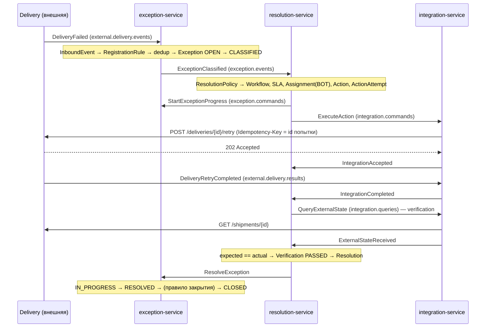
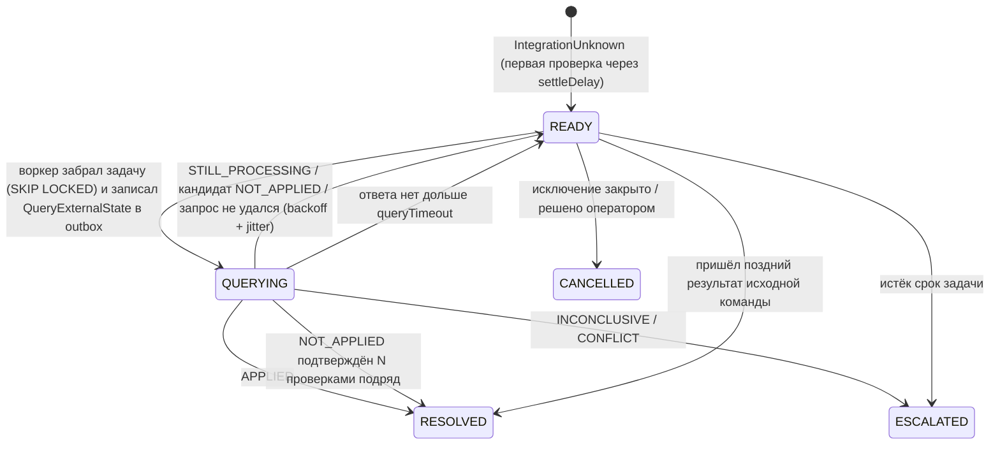

# Архитектура

## Сервисы и владение данными

| Сервис | Отвечает на вопрос | Владеет | Outbox | Идемпотентность входа |
|---|---|---|---|---|
| exception-service | что случилось и в каком это статусе | Exception, Reference, Relation, History, правила регистрации и классификации | polling (`FOR UPDATE SKIP LOCKED`) | `inbound_event UNIQUE(source_system, event_id)` для внешних событий; `inbox` для команд |
| resolution-service | как это решить и решено ли | Workflow, Action, ActionAttempt, ReconciliationTask, Verification, Resolution, SLA, Escalation, WorkItem | append-only + Debezium CDC | `inbox` |
| integration-service | как технически вызвать внешнюю систему | IntegrationOperation, IntegrationAttempt | polling | первичный ключ операции = id из команды |
| analytics-service | что происходит в целом | raw_event, exception_fact | нет исходящих | первичный ключ `raw_event` |

У каждого сервиса своя база. Чужую базу никто не читает; синхронных вызовов между сервисами нет — только Kafka.

## Поток: успешное асинхронное разрешение

## Поток: timeout и UNKNOWN

Кто что решает:

- **Integration** классифицирует транспортный исход (`TransportClassifier`):
  `NOT_SENT` (точно не дошло: нет соединения, breaker открыт, 429/503) → транспортный retry безопасен;
  `REJECTED` (4xx) → точно не применено; `UNKNOWN` (read timeout, обрыв, 5xx) → вслепую не повторяется.
- **Resolution** интерпретирует наблюдение (`ObservationInterpreter`) и решает, применено ли действие, повторять ли
  его (новый `ActionAttempt` = новый ключ идемпотентности) или отдать оператору.
- Подтверждённый `NOT_APPLIED` ведёт к автоповтору только если это разрешено флагом `auto_retry_enabled`
  в `reconciliation_policy` для пары «система + тип действия».
- Если после объявленного `NOT_APPLIED` приходит успех первой команды, это `CONFLICT_REVIEW` + метрика
  `reconciliation_false_not_applied_total` + critical-алерт.

## Гарантии доставки

Модель — **at-least-once + идемпотентная обработка**. Глобальный exactly-once не обещается.

| Участок | Что может случиться | Чем закрыто |
|---|---|---|
| Бизнес-изменение и сообщение | закоммитили изменение, потеряли событие | outbox в той же транзакции (`OutboxWriter`, `Propagation.MANDATORY`) |
| Outbox → Kafka | дубль при падении между send и commit / рестарте коннектора | inbox у потребителя |
| Kafka → обработчик | повторная доставка, два потребителя параллельно | `INSERT … ON CONFLICT DO NOTHING` в inbox в одной транзакции с изменением |
| Порядок | события одного исключения | ключ записи = exceptionId; `aggregateVersion` в заголовке для проверки там, где порядок важен |
| «Ядовитое» сообщение | бесконечные ретраи блокируют партицию | `DefaultErrorHandler`: backoff → `<topic>.dlt`; невалидное сообщение сразу в DLT |
| Команда не подходит к состоянию | — | не ошибка инфраструктуры: `ExceptionCommandRejected`, партиция не блокируется |
| Падение между «операция зарегистрирована» и «результат сохранён» (integration) | неизвестно, ушёл ли запрос | при повторной доставке операция в `RECEIVED` → `IntegrationUnknown(INTERRUPTED)`, без повторного вызова |

Конверт сообщения: метаданные в **заголовках Kafka** (`id`, `eventType`, `aggregateVersion`, `correlationId`,
`causationId`, `occurredAt`, `traceparent`), значение — JSON payload. Одинаковые заголовки формируют и polling-relay,
и Debezium Outbox Event Router, поэтому потребителю не важно, каким способом сообщение доставлено.

## Топики

| Топик | Кто пишет | Кто читает | Владелец контракта |
|---|---|---|---|
| `external.delivery.events` | Delivery | exception | команда Delivery |
| `external.delivery.results` | Delivery | integration | команда Delivery |
| `exception.events` | exception | resolution, analytics | exception (producer) |
| `exception.commands` | resolution | exception | exception (consumer) |
| `resolution.events` | resolution | analytics | resolution |
| `integration.commands` | resolution | integration | integration (consumer) |
| `integration.queries` | resolution | integration | integration (consumer) |
| `integration.events` | integration | resolution, analytics | integration |
| `<topic>.dlt` | обработчик ошибок потребителя | люди | потребитель |
| `__debezium-heartbeat.resolution-cdc` | Debezium | — | resolution |

Группы потребителей названы `<сервис>.<поток>` (например `integration-service.commands`), чтобы lag каждого потока
был виден отдельно.
