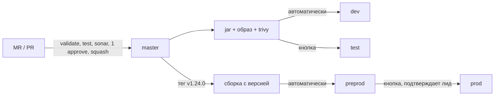

# CI/CD

В репозитории два эквивалентных описания пайплайна: `.github/workflows/*` (репозиторий сейчас на GitHub)
и `.gitlab-ci.yml` (целевая платформа). Логика выкладки вынесена в `scripts/deploy.sh`, чтобы не дублироваться.

**Ни один из двух пайплайнов не запускался** — проверен только синтаксис YAML. См. [deviations.md](deviations.md).

## Как код попадает на стенды



| Окружение | Как попадает | Кто пользуется | Реализация в GitLab | Реализация в GitHub |
|---|---|---|---|---|
| local | никак, запускаешь сам | разработчик | — | — |
| dev | автоматически после мержа | разработчики | `deploy-dev`, `rules: default branch` | job `deploy-dev` |
| test | кнопкой | QA | `deploy-test`, `when: manual` | environment `test` с required reviewers |
| preprod | релизный тег | регресс | `deploy-preprod`, `rules: $CI_COMMIT_TAG` | `release.yml` |
| prod | тот же тег, подтверждение лида | — | `deploy-prod`, `when: manual` + protected environment | environment `prod` с required reviewers |

Почему test — кнопкой: если каждый мерж перевыкатывает стенд, тестировщику подменяют версию посреди проверки.

## Стадии

| Стадия | Что делает | Что ловит |
|---|---|---|
| validate | `helm lint` всех values, `promtool check rules`, сверка сгенерированных манифестов с источниками | сломанный чарт или алерт до выкладки; расхождение конфига коннектора |
| test | `mvn verify`: unit + интеграционные (Testcontainers) + порог JaCoCo | регрессии, падение покрытия |
| quality | SonarQube с ожиданием quality gate | покрытие нового кода, code smells, уязвимости в коде |
| package | образ на сервис (matrix), push в реестр | — |
| scan | Trivy: HIGH/CRITICAL с доступным исправлением | уязвимые зависимости и базовый образ |
| deploy-* | `kubectl apply` платформенных ресурсов → `helm upgrade --atomic` → коннектор | неготовые поды: `--atomic` откатывает релиз |

Сборка один раз: jar собирается в `test`, передаётся артефактом, образ только распаковывает его. Один и тот же
образ с тегом версии идёт на preprod и на prod.

## Версии

- Обычная сборка: `0.0.1-SNAPSHOT`, тег образа = sha коммита.
- Релиз: тег `v1.24.0` → `mvn -Drevision=1.24.0` (CI-friendly versions + `flatten-maven-plugin`) → образ `:1.24.0`.
- Тег фиксирует набор изменений: мержи в master после тега в релиз не попадают.

## Откат

```bash
helm rollback resolution-service --namespace demp-prod --wait
```

Откатывается образ и конфигурация, **но не схема БД**. Поэтому миграции пишутся обратно совместимыми в два релиза
(expand → contract): сначала добавить колонку и научить код жить с обеими, удалять старую — в следующем релизе.
Проверка на ревью: «старая версия сервиса работает на новой схеме?»

## Хотфикс

1. Ветка `hotfix/DEMP-123-...` от релизного тега.
2. Ускоренное ревью, пайплайн, выкладка на test или preprod.
3. Тег `v1.24.1` на ветке хотфикса → preprod → prod вне графика с подтверждением лида.
4. Исправление вливается в master.

## Git-процесс

Упрощённый GitLab Flow: `master` + короткие ветки `feature/DEMP-123-short-desc`, `bugfix/...`, `hotfix/...`;
коммиты `DEMP-123: ...`; rebase на master перед MR; слияние squash. Условия мержа: зелёный пайплайн, quality gate,
1 апрув; для путей из `CODEOWNERS` (миграции, контракты, коннектор) — апрув senior или лида.

## Перенос на GitLab

Файл `.gitlab-ci.yml` уже лежит в корне: после импорта репозитория пайплайн появится сам. Что нужно настроить руками:

| Что | Где в GitLab | Зачем |
|---|---|---|
| Runner с Docker и privileged-режимом | Settings → CI/CD → Runners | Testcontainers и сборка образов идут через `docker:dind`. Альтернативы без privileged: сборка образа через BuildKit rootless / Buildah; для тестов — socket-binding (хуже изоляция) или внешние БД/Kafka как `services:` |
| Container Registry | Deploy → Container Registry | `$CI_REGISTRY_IMAGE` используется как префикс образов |
| `SONAR_HOST_URL`, `SONAR_TOKEN` (masked) | Settings → CI/CD → Variables, либо `secrets:vault` | джоб `sonarqube` включается только при заданном URL |
| Доступ к кластерам | GitLab agent for Kubernetes: контексты `<project>:dev` … `<project>:prod` | джобы `deploy-*` делают `kubectl config use-context` |
| Protected branch `master`, protected tags `v*` | Settings → Repository | прямые пуши запрещены; тег может ставить ответственный за релиз |
| Protected environment `prod` | Settings → CI/CD → Protected environments | кнопку `deploy-prod` может нажать только лид |
| Merge request approvals + Code Owners | Settings → Merge requests | 1 апрув; пути из `CODEOWNERS` требуют владельца (в GitLab — платная редакция) |
| Squash commits: require | Settings → Merge requests | «слияние — squash» |
| Шаблон MR | уже в `.gitlab/merge_request_templates/Default.md` | чек-лист миграций и контрактов |

Соответствие понятий:

| GitHub Actions | GitLab CI |
|---|---|
| workflow / job / step | pipeline / job / script |
| `needs` | `needs` (+ порядок `stages`) |
| `strategy.matrix` | `parallel:matrix` |
| reusable workflow (`workflow_call`) | `extends`, `include`, `!reference` |
| environment + required reviewers | environment + protected environment, `when: manual` |
| `concurrency` | `resource_group`, `interruptible` |
| `secrets.*` | CI/CD variables (masked/protected), `secrets:vault` |
| `upload-artifact` / `download-artifact` | `artifacts` / `needs` |
| `actions/cache` | `cache` |
| GHCR | GitLab Container Registry |

Чего нет в `.gitlab-ci.yml` и что обычно добавляют: шаблоны GitLab `SAST`, `Secret-Detection`, `Dependency-Scanning`
(`include: template: ...`), `rules:changes` для сборки только изменённых сервисов.

## Если разрезать на репозитории (как в исходном описании)

- `platform-common` и `contracts` становятся артефактами во внутреннем реестре (Nexus / GitLab Package Registry)
  со своими версиями; сервис обновляет зависимость осознанно (Renovate откроет MR).
- У каждого сервиса свой `.gitlab-ci.yml`, обычно это `include` общего шаблона из репозитория devops-команды.
- Общий Helm-чарт публикуется в реестр чартов; в репозитории сервиса остаются только `deploy/values*.yaml`.
- Топики и коннекторы применяет пайплайн платформенной команды из своего репозитория.
- Цена: изменение контракта — это уже несколько MR в порядке «библиотека → потребители → продюсер».
